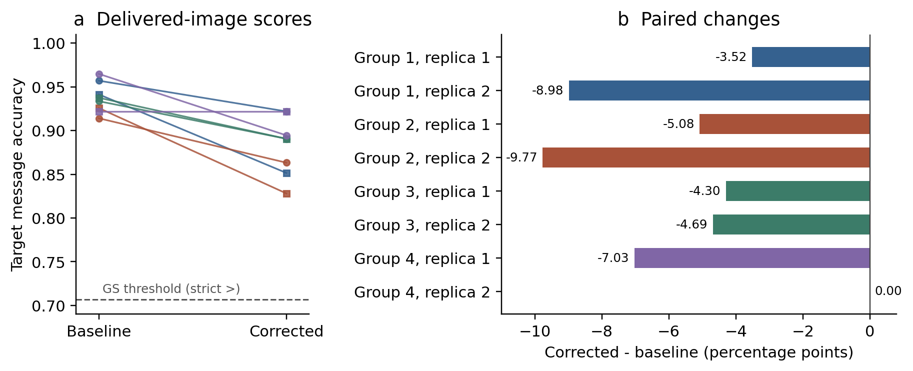

# Delivery-path objectives for black-box diffusion watermark forgery

Working methods and results sections. The complete three-method development comparison is pending. A novel or superior method is not established by the evidence available for this draft.

## Problem and evaluation boundary

We study whether a proxy-model optimization objective can transfer watermark evidence from a reference image to an image with a specified cover content. The attacker receives a watermarked reference image, a cover image, and the fixed proxy configuration. Watermark messages, encryption keys and nonces, target-model initial noise, and target-model inversion outputs are restricted to evaluation. Candidate images are fixed before their target scores are computed. This workflow separates the computational roles and their inputs; the implementation uses a shared operating-system account and does not provide permission isolation.

The evaluated endpoint is ordinary Gaussian Shading (GS) detection, together with decoded-message accuracy, distortion relative to the cover, and computation time. Gaussian Shading embeds a message through the initial noise and recovers it through inversion and decoding [1]. Ordinary detection is one component of the broader forgery question. Semantic content preservation and acceptance by complete content-binding or geometry defenses require their own evidence. Those outcomes remain unknown in this study.

## Compared objectives

Let \(r\) and \(c\) denote the reference and cover images. Let \(E_s\), \(D_s\), and \(I_s\) denote proxy VAE encoding, VAE decoding, and diffusion inversion, respectively. We use \(C\) for the fixed pixel-range conversion and clipping operation, and \(Q\) for the conversion to the exported 8-bit image. The shared reference target is

\[
q_r=I_s(E_s(r)).
\]

The native Imprint objective optimizes a latent variable initialized from the cover, \(z_0=E_s(c)\), by minimizing

\[
L_{\mathrm{native}}(z)=\operatorname{mean}\big[(I_s(z)-q_r)^2\big].
\]

This comparison retains the inversion-matching mechanism of Imprint [2]. The delivery-path candidate inserts the differentiable decode, clip, and encode path into that objective:

\[
R_s(z)=E_s(C(D_s(z))),\qquad
L_{\mathrm{delivery}}(z)=\operatorname{mean}\big[(I_s(R_s(z))-q_r)^2\big].
\]

Both variants use ten Adam updates with learning rate 0.01, the same cover initialization, and the same reference target. Proxy inversion uses 50 steps, an empty prompt, and guidance scale 1. The final output is the single image \(x=Q(C(D_s(z_{10})))\); no intermediate candidate is selected by target scores. The optimization objective is continuous. Its derivative does not differentiate the discrete 8-bit quantizer. Evaluation rereads the exported PNG so that reported detection and distortion correspond to the image actually delivered.

The delivery implementation computes the continuous composition gradient in two parts. It first differentiates the inversion loss with respect to a detached encoded latent \(u=R_s(z)\), then recomputes \(R_s(z)\) and propagates that gradient through the decode–clip–encode mapping. This applies the chain rule to the specified deterministic continuous computation while avoiding simultaneous retention of both computation graphs. It is an implementation of the stated objective, not a guarantee of transfer to the target model.

The third comparator adapts the single-image VAE-matching core of Jain et al. [3] to the same SD2.1 proxy. Its frozen configuration uses 447 updates, \(\lambda=10000\), \(\alpha=5/255\), and zero initial perturbation. Upstream VAE parameter-gradient flags are retained. The update count follows earlier resource calibration in this project. This comparator is explicitly a short-budget adaptation; it does not reproduce the original paper's complete model and optimization settings. Equal update counts for the two Imprint variants also do not establish equal computation. We measure actual core time and apply the frozen time-ratio criterion below.

## Development design

The target is Stable Diffusion XL base 1.0 at revision `462165984030d82259a11f4367a4eed129e94a7b`. The proxy is the local SD2.1 base snapshot at revision `0094d483a120f3f33dafbd187ea4aa60d10de75c`. Images have resolution 512 by 512 and model computation uses float32. Reference and cover generation use 50 DDIM steps and guidance scale 7.5. Target evaluation uses 50 DDIM inversion steps, an empty prompt, and guidance scale 1.

The frozen design contains four reference/cover prompt groups with three seeded replicas per group. The requested cover contents are a bicycle, a lighthouse, a violin, and a cat; each is paired with a different reference content. A separate GS encryption state is assigned to each reference. The twelve tasks are shared by all three methods. These are development tasks used to screen a specific candidate, rather than a held-out confirmation benchmark. Replicas share prompt groups, so twelve task-level observations do not justify treating all variation as independent population sampling.

GS uses a 32-byte message, 64 replications, \(l=1\), and offset 0. The fixed decision is strict: a candidate passes when message bit accuracy is greater than 0.70703125. Equality is a rejection. We report pass counts and continuous message accuracy separately. Pixel MSE is calculated between reread RGB PNGs in [0,1], and PSNR uses data range 1. Pixel distance is not a formal semantic-content label.

The primary comparison is delivery-path versus native Imprint, paired by task. The candidate is retained for independent confirmation only if all twelve references pass GS, delivery produces at least three additional GS passes, the median within-task pixel-MSE ratio (delivery/native) is at most 1.05, and the median within-task core-time ratio is at most 1.15. All four requirements were frozen before the first model execution. Complete evidence that fails the rule closes this fixed candidate; missing required evidence yields an inconclusive outcome. The decision is a development screening rule, not a statistical-significance test.

The original launch stopped when the preimport device-idle check rejected task 2's Jain process. That process produced no candidate. Its failed execution record is retained, and it is not replaced or retried. The continuation reuses the nine successfully completed original processes and runs only work that had never started. Consequently, the maximum available comparison contains 35 candidate images, 12 reference images, and 12 cover images, giving 59 target inversions. The primary delivery/native comparison still plans twelve pairs. Jain retains a twelve-attempt denominator, with any conditional summaries over its eleven delivered images identified explicitly. This missingness is an engineering event, not evidence that Jain's watermark objective failed.

## Completed evidence: reference recovery and image delivery

A preceding closed diagnostic evaluated a fixed source-trained correction of proxy-inverted reference noise. On eight target-generator references, mean latent-bit error decreased from 0.43940735 to 0.43641663, and mean decoded-message accuracy increased from 0.82958984 to 0.83935547. These are reference-recovery measurements, before an image is regenerated and inverted by the target evaluator.

The following fixed paired delivery study generated images from the baseline and corrected representations under matched generation randomness. It sealed all sixteen candidates before evaluating them. The saved verification record independently decoded all 24 reference and candidate scores. Mean target message accuracy was 0.93701172 for baseline delivery and 0.88281250 for corrected delivery, a paired change of -0.05419922. Accuracy decreased in seven pairs and tied in one; none improved. Every reference had accuracy 1.0. Both delivery conditions nevertheless passed ordinary GS on all eight tasks. Thus, the discrete pass count concealed a decrease in the continuous message-accuracy endpoint.

Table 1. Closed eight-pair delivery diagnostic. Accuracy is a fraction of message bits; the change is corrected minus baseline. These are descriptive development results from four prompt groups, with two replicas per group.

| Endpoint | Baseline | Corrected | Paired change |
|---|---:|---:|---:|
| Mean target message accuracy | 0.93701172 | 0.88281250 | -0.05419922 |
| Ordinary GS pass count | 8/8 | 8/8 | 0 |
| Pairs with higher message accuracy after correction | — | 0/8 | — |
| Pairs with unchanged message accuracy | — | 1/8 | — |
| Pairs with lower message accuracy | — | 7/8 | — |

Figure 1. Delivered-image message accuracy for every pair in the closed diagnostic. Colors denote the four prompt groups; circles and squares distinguish replicas in panel a. All scores exceed the strict GS threshold despite seven negative paired changes. Panel b reports percentage-point differences. The underlying saved rows, plotting code, and source hash are provided with [the figure manifest](../reports/27_recovery_audit_20261019/figure_manifest.json).

The recovery and delivery measurements concern different points in the image pipeline. Their contrast supports a narrow empirical conclusion: improvement in this proxy reference-recovery metric did not predict an improvement in delivered-image message accuracy for the fixed mapping and tasks tested. The mapping was closed under its predeclared nonpositive-endpoint rule. These results motivate measuring complete delivered images in the new method comparison, but they do not establish that the delivery-path Imprint candidate will be effective.

## Complete method comparison: result pending

The three-method comparison is still running. Target detection is scheduled after all deliverable candidates have been sealed. Completed attack processes or decreasing proxy losses are insufficient to populate the target-result table. Final pass counts, paired accuracy differences, cover-MSE ratios, core-time ratios, and the frozen go/no-go decision therefore remain pending. The final analysis must retain task 2/Jain as missing and apply the twelve-attempt denominator described above.

## Limitations and claim scope

The study currently covers one proxy/target pair, one ordinary watermark detector, and a small set of development prompt groups. The Jain adaptation changes its original computational budget and proxy. Human content labels and complete geometry or semantic-binding defense decisions are unavailable. A successful development screen would require independent confirmation, a cost-controlled comparison, and evidence distinguishing the contribution from existing inversion matching and reconstruction-aware attack objectives. A failed screen would close this candidate under the frozen decision rule. Neither outcome should be generalized to population attack success or to untested defenses.

## Evidence and references

The numerical design is [protocols/27_method_design.json](../protocols/27_method_design.json). The evaluated code is [method_comparison/attack.py](../scripts/method_comparison/attack.py) with the original cores in [cover_pilot/attack.py](../scripts/cover_pilot/attack.py). The reference-recovery record is [stage24](../reports/24_cross_generator/report.md), and the completed delivery values are in [stage25 verification](../reports/25_delivery_transfer/verification.json). The independent continuation audit is [remote_provenance.json](../reports/27_recovery_audit_20261019/remote_provenance.json); it verifies provenance, not scientific efficacy.

1. Yang et al. *Gaussian Shading: Provable Performance-Lossless Image Watermarking for Diffusion Models*. 2024. [Primary paper](https://arxiv.org/abs/2404.04956).
2. Müller et al. *Black-Box Forgery Attacks on Semantic Watermarks for Diffusion Models*. CVPR 2025. [Primary paper](https://openaccess.thecvf.com/content/CVPR2025/papers/Muller_Black-Box_Forgery_Attacks_on_Semantic_Watermarks_for_Diffusion_Models_CVPR_2025_paper.pdf).
3. Jain et al. *Forging and Removing Latent-Noise Diffusion Watermarks Using a Single Image*. arXiv:2504.20111v1, 2025. [Primary paper](https://arxiv.org/abs/2504.20111v1).
