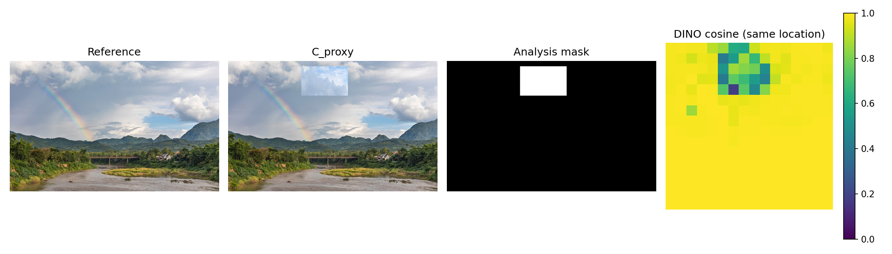

# 阶段 2：基线最小闭环与服务器实际运行检查

执行日期：2026-09-17（Asia/Shanghai）。结论：代码、CPU 测试、真实权重加载、GPU 小规模推理与评测闭环均已完成；B 类数据仍缺失。本报告评价“查询图像是否属于参考图的允许变体”，使用参考图特征，不推断生成来源、版权或内容真实性。

## 1. 实际环境与运行

服务器 `server249`，Ubuntu 18.04.6 LTS。项目 `/data0/liyanlei/instance_authentication_research`。使用已有 `/data0/liyanlei/envs/stego_attack/bin/python`：Python 3.10.20、PyTorch 2.3.1+cu121、torchvision 0.18.1+cu121、CUDA build 12.1、cuDNN 8902、NumPy 1.26.4、Pillow 10.4.0、matplotlib 3.10.9。未安装、升级或修改环境。通过绝对路径启动已有环境，进程 `sys.prefix` 已验证；登录 shell 的 CONDA_PREFIX/VIRTUAL_ENV 均未设置。项目内未找到单独的环境配置说明或额外 AGENTS.md。

检查时 `/data0` 文件系统总计约 7.3 T、剩余约 1.3 T。历史记录中的 `296G` 是用户目录已使用量，不能解释为可用空间。保留原阶段 1 环境文件；本阶段实际命令、时间和输出见 `research/02_server_environment.txt`。

|宿主机编号|完整 UUID|CUDA driver PCI bus ID|任务|最终进程 PID|可见 GPU 数 / 退出码|
|---|---|---|---|---|---|
|5|`GPU-e6f35928-0155-f121-e707-1eaf3c14965c`|`0000:89:00.0`|clip_sscd|7086|1 / 0|
|7|`GPU-9644fb82-cb6f-7311-8017-eaee41409bb7`|`0000:B2:00.0`|dinov2|7087|1 / 0|

两进程均在启动前设置单个完整 UUID，内部设备为 `cuda:0`。启动流程先校验白名单与宿主机 nvidia-smi，再用 CUDA driver API 读取实际 UUID/PCI；PyTorch 初始化后再次校验可见数，并用 nvidia-smi PID 行验证实际绑定。CPU 入口均隐藏 CUDA；测试用模拟非法 UUID 校验禁止设备，不向 GPU 6 分配张量。没有容器标记或调度任务变量；未修改资源隔离设置。

本阶段另两次实际运行的GPU5/GPU7 PID分别为4001/4002（来源预检查）和5727/5728（照片数据确认）；同样使用上述UUID限制。各次原始绑定和资源记录保留在服务器的outputs/runs及outputs/audit_preflight中；本表与指标使用最终全量特征重提取运行。

GPU 5 原有进程 PID 14413 在前后快照均存在，显存 1106 MiB；整卡占用 1112 MiB。GPU 7 前后占用 1 MiB。无 OOM、无任务迁移、无停止其他进程或全局 GPU 设置变更。每卡本项目最多一个工作进程，batch=1，CPU线程2，设置进程分配器上限18%而非预占整卡。单次 GPU 任务不足30秒，未触发30秒低频监测周期；`gpu_during.json` 为零次周期采样，模型加载后另有 PID 绑定快照。证据覆盖本轮启动配置和进程，不能据此保证共享任务性能完全不受影响，也不以结束快照推断全服务器历史。

## 2. 数据、划分与图像处理

20 张许可明确的 Commons 自然照片，主要是风景/乡村场景，领域覆盖有限。来源、作者、许可、URL、原始文件 SHA-256 见 `research/02_sources.md` 和 `data/stage02/sources.json`。原始缩略图最大宽度640，统一 RGB 后最长边限512（Lanczos、保持比例），再保存 PNG。未使用提示词或类别文本参与模型打分。

随机种子20260917；先按原图与近重复连通分量划分，再生成变体。校准/测试各10个原图组；dHash距离≤8/64或32×32 RGB MSE<0.002作为近重复筛查，未检出边；已查看原图总览，未发现跨集合近重复。此筛查不构成普遍的近重复检测保证。供体仅从同集合、不同原图组选择。

|类别|校准对数|测试对数|定义|
|---|---:|---:|---|
|A|60|60|每图JPEG Q90/Q70、缩放0.75/0.5后恢复、亮度0.95/1.05，各6个独立变体|
|D|45|45|同集合不同原图的无序组合|
|C_proxy|20|20|每图5%、15%面积的矩形供体贴片|
|SELF|10|10|只检查同图分数，不计入校准或A|
|B|0|0|missing：没有真实同提示词不同随机种子生成数据|

共180张推理图像、270个配对（含20个SELF）。JPEG实际经 Pillow 编码/解码，subsampling=2，再存 RGB PNG；缩放为Pillow bicubic两步；亮度为Pillow ImageEnhance；C_proxy先把供体bicubic到目标尺寸再粘贴指定矩形，实际像素面积因整数取整略异于目标。每个参数、供体、mask、路径和图像哈希可由 `manifest.json` 追溯。每项编辑独立进行，全部输出使用一致PNG压缩设置。

数据质量审计记录：首次来源预检查含 Commons 30727835 风景画；按照片类型要求，以冻结查询顺序中的下一张合格照片44683621替换。理由、首次清单和运行记录保留于 `source_audit.json`、服务器 `outputs/audit_preflight/` 与 `outputs/runs/`，未按模型分数筛选图像。最终自然照片流程重新按相同种子划分并执行，随后全量重新提取验证；最终两次运行阈值相同。初次结果不混入本表。

## 3. 模型、预处理和分数

三个模型使用真实官方权重、eval模式、参数冻结、float32；DINOv2关闭可选xFormers，使用官方普通注意力实现。官方接口证据：[CLIP](https://github.com/openai/CLIP/blob/d05afc436d78f1c48dc0dbf8e5980a9d471f35f6/clip/clip.py)、[SSCD inference](https://github.com/facebookresearch/sscd-copy-detection/blob/95902662f2217a5f4aa45f2a3fc70a01dfd3b66a/README.md#inference-using-sscd-models)、[DINO backbone](https://github.com/facebookresearch/dinov2/blob/7764ea0f912e53c92e82eb78a2a1631e92725fc8/dinov2/hub/backbones.py)。详细下载URL见 `artifacts/models.json`。

|模型|权重字节|权重 SHA-256|官方代码 commit|
|---|---:|---|---|
|clip|353,976,522|`40d365715913c9da98579312b702a82c18be219cc2a73407c4526f58eba950af`|`d05afc436d78f1c48dc0dbf8e5980a9d471f35f6`|
|sscd|98,791,638|`9f26bd4c848cc19b73d2ae92eea6e04886f61a7b764ceb7a13aeee62e6a6db56`|`95902662f2217a5f4aa45f2a3fc70a01dfd3b66a`|
|dinov2|88,283,115|`b938bf1bc15cd2ec0feacfe3a1bb553fe8ea9ca46a7e1d8d00217f29aef60cd9`|`7764ea0f912e53c92e82eb78a2a1631e92725fc8`|

包含代码归档、模型和样本的全部新增下载记录合计 552,329,194 字节（552.3 MB），低于1.5GB；无扩散生成模型下载。服务器下载代码归档连接重置，最终由本机从相同官方来源下载并 SCP 传入，服务器按SHA核验并运行。CLIP校验官方URL携带的SHA；SSCD/DINO记录测得SHA供复现核验，不声称作者发布了签名。

- CLIP ViT-B/32：官方 `clip.load(..., device='cpu', jit=False)`，转float32到指定GPU；`encode_image`，512维L2归一化后余弦。官方短边224 bicubic、中心裁剪224；均值(0.48145466,0.4578275,0.40821073)，标准差(0.26862954,0.26130258,0.27577711)。
- SSCD `sscd_disc_mixup.torchscript.pt`：`torch.jit.load`，作者推荐的`skew_320`全图bilinear缩放320×320；ImageNet均值/标准差；512维描述子L2归一化后余弦。没有使用DISC阈值。
- DINOv2 ViT-S/14：官方结构工厂加官方state_dict严格完整加载，`forward_features(x)['x_norm_patchtokens']`；全图bicubic缩放224×224，无裁剪，ImageNet归一化，得到16×16×384 patch。每patch先L2；global为patch均值再L2；local_mean为同位置patch余弦平均；local_q10用 `numpy.quantile(...,0.1,method='linear')`，即排序后位置 `(n−1)×0.1` 线性插值。两局部分数全部保留。

特征提取器输入只有图像ID/路径/哈希，不接触标签、供体或mask。缓存键含图像SHA、权重SHA、代码commit、预处理和缓存版本；按模型独立写入、临时文件原子替换。DINO三个分数共享一次patch提取，global另存均值向量，用于实际全局比较。

CLIP只看中心裁剪而另外两者看完整画面。`crop_visibility.json` 记录贴片与中心正方形的连续坐标交叠比例（缩放取整约1像素误差），实际有0到1的可见比例；边缘改动不可见是预处理差异，不能解释成语义或局部机制优势。

## 4. 阈值与最终测试结果

所有分数越高越接受。仅使用校准A，令n=60，阈值取升序第 `floor(0.05n)=3` 个元素（0起始索引，即第4小）。接受条件为 `score >= threshold`，相等分数接受；校准拒绝数最多3，遇重复边界可能更少。先保存 `thresholds.json` 及哈希，再计算测试指标。测试标签/分数扰动不影响校准阈值的单元测试通过。

|方法|阈值|校准A FRR|测试A FRR|测试D错误接受|测试C_proxy错误接受|
|---|---:|---:|---:|---:|---:|
|CLIP_global|0.946947217|3/60 (5.00%)|8/60 (13.33%)|0/45 (0.00%)|5/20 (25.00%)|
|SSCD_global|0.917983532|3/60 (5.00%)|1/60 (1.67%)|0/45 (0.00%)|5/20 (25.00%)|
|DINO_global|0.986206293|3/60 (5.00%)|5/60 (8.33%)|0/45 (0.00%)|2/20 (10.00%)|
|DINO_local_mean|0.960199714|3/60 (5.00%)|3/60 (5.00%)|0/45 (0.00%)|0/20 (0.00%)|
|DINO_local_q10|0.931500494|3/60 (5.00%)|4/60 (6.67%)|0/45 (0.00%)|2/20 (10.00%)|

校准FRR相同，测试FRR并不相同。这是流程检查，不能将上表包装为相同测试FRR下的严格性能排名。D=45对来自10张原图，C_proxy=20对来自10个组，派生配对不独立；0/20或0/45不能支持极低误报率，也不称为主动攻击成功率。B未评测。

## 5. 参考信息与实际成本

|方法|特征维度|精度|数组字节/参考图|实测.npy字节/参考图|
|---|---|---|---:|---:|
|CLIP_global|512|float32|2,048|2,176|
|SSCD_global|512|float32|2,048|2,176|
|DINO_global|384|float32|1,536|1,664|
|DINO_local_mean|256×384|float32|393,216|393,344|
|DINO_local_q10|256×384|float32|393,216|393,344|

DINO_global的参考向量为1.5KiB，而任一局部分数使用384KiB的完整参考patch数组（256倍）；共享提取缓存仍保存完整patch。这些字节不含路径索引/JSON元数据、模型权重或未来签名/纠错。没有原图之外的额外参考信息；当前局部信息开销不能视作免费水印载荷。

|模型|PID|总图/实际提取/缓存命中|加载秒|180图提取及写缓存秒|本进程峰值allocated MiB|本进程峰值reserved MiB|
|---|---:|---|---:|---:|---:|---:|
|clip|7086|180 / 180 / 0|3.932|3.075|614.50|670.00|
|sscd|7086|180 / 180 / 0|0.425|1.882|264.46|302.00|
|dinov2|7087|180 / 180 / 0|0.625|2.937|120.85|146.00|

GPU 5顺序释放CLIP再加载SSCD。显存为PyTorch本进程统计，不包含GPU5既有进程；驱动context另有开销，可看按PID的nvidia-smi证据。提取时间包含预处理、推理、CPU回传和缓存写入，不含加载和前置重复提取自检。CPU逐对时间（270对）记录在metrics：

- CLIP_global: 0.001520 秒。
- SSCD_global: 0.000827 秒。
- DINO_global: 0.001526 秒。
- DINO_local_mean: 0.004986 秒。
- DINO_local_q10: 0.027533 秒。
- DINO两局部分数共享的逐patch余弦计算另计 0.014745 秒。

共享负载与不同GPU使这些时间只能作为运行成本记录，不构成速度优势比较。

## 6. 测试与代表性错误

`python -m unittest discover -s tests -v`：9项通过，退出0。覆盖阈值/相等边界/FRR/错误接受/线性分位数、测试数据隔离、缓存失效、归一化、清单/供体/近重复泄漏和GPU配置拒绝。真实运行内每模型重复提取误差0，自相似最大误差≤2.4e−7；180张全部维度、范数、有限值检查通过。

`python scripts/check_stage02_results.py`：9项产物审计通过，退出0；独立复算CSV阈值/计数，核实图像SHA/RGB PNG/JPEG像素变化、权重SHA、特征尺寸/字节数、DINO全局衍生关系和实际PID绑定。统一入口退出0，三个模型状态complete。全部日志在outputs/stage02/logs，单元测试与运行审计分别记录，不将代码存在等同于推理成功。

- CLIP对 `commons_114956623_jpeg70` 拒绝：真实有损压缩的正常样本。
- CLIP接受 `commons_114956623_patch0.05`；SSCD与DINO_global接受 `commons_100018635_patch0.05`：C_proxy错误接受样例。
- DINO_local_mean拒绝 `commons_69468782_jpeg70`：局部分数也会拒绝允许变体。
- DINO_local_q10接受 `commons_73462291_patch0.05`：固定分位数对小面积变化仍可能不敏感；这是结果解释假设，未另做机制验证。

代表样本按每方法首个错误确定性选取；完整分数见CSV，错误图含参考图、查询图和分析mask。局部相似度热图仅做诊断，不声称定位认证能力。图像许可与改动说明见02_sources.md。



## 7. 可复现命令

```bash
cd /data0/liyanlei/instance_authentication_research
export CUDA_VISIBLE_DEVICES=""
export PATH=/data0/liyanlei/envs/stego_attack/bin:$PATH
# 若需要conda激活，可由已有conda入口运行 conda activate /data0/liyanlei/envs/stego_attack；
# 本次实际采用以上PATH及绝对解释器，运行入口校验sys.prefix。
python scripts/run_stage02.py --config configs/stage02.json --refresh-features
```

不传refresh时复用缓存；每次运行自动归档旧outputs/stage02，避免失败模型沿用旧结果。首次准备见README的acquire脚本，固定官方源码与权重清单，数据使用已保存Commons查询快照。无需重新创建环境。原图/权重/缓存留在服务器，不放GitHub；代码、来源清单、哈希、CSV/JSON、报告、图表与日志同步私有仓库。

## 8. 研究解释与停止点

本轮证明三种现成表示及五种固定分数的实现可运行和可追溯。DINO局部均值在这个贴片集合上错误接受较少，但未确认新颖性、实例级认证安全性或紧凑局部摘要价值。复制检测SSCD容忍部分变化符合其原任务，不能不加认证定义地称为漏洞。密集patch的成本远高于全局向量；粗糙贴片可被拼接痕迹识别，不代表自然局部语义编辑。

D易区分不说明B易区分；没有凭证嵌入/提取/签名/自适应主动冒认评测，不能称为防伪认证水印。下一阶段优先补齐一个条件：**来源可核验的同提示词、不同随机种子、同生成模型与保存流程的B类实例组**，保持组级划分并重新独立校准。自然局部替换、匹配参考信息预算和公开验证攻击仍是后续未核实问题。

阶段2到此停止，不训练、不扩展数据规模、不进入阶段3。
