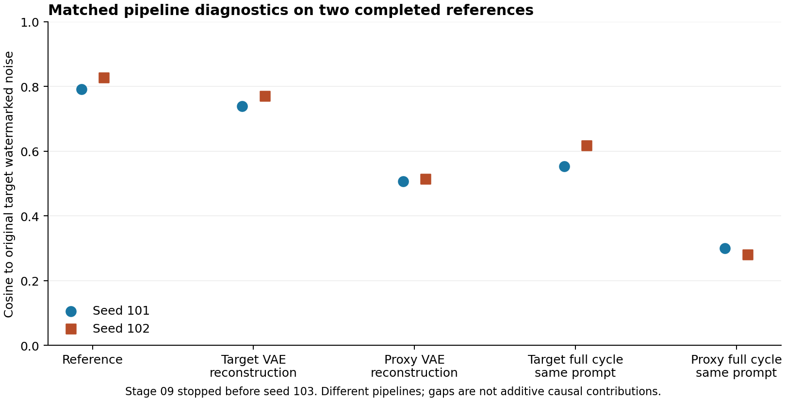

# VAE 编解码与目标反演诊断：2/3 种子完成

固定的三个种子中，101、102 各完成两个 VAE 条件，103 在 GPU 预检阶段停止，未启动模型进程。本组保留为未完成的开发对照；两个已完成种子的观察只作描述，不补样、不自动重跑，不用它们代表完整预定组。

## 实验定义

对阶段 07 保存的同一张真实参考 PNG，分别用目标 SDXL VAE 与代理 SD2.1 VAE 重建，然后由目标 SDXL 进行原参数反演和 GS 检测。无扩散生成调用、无新水印噪声采样、无优化或参数搜索。两个参考的复算目标反演均与阶段 07 NPY 完全一致。

编解码：RGB/255 → 2x−1 → VAE posterior.mean → 乘 scaling_factor → 除同一 scaling_factor 后 decode → diffusers image_processor.postprocess 的 PIL 量化。目标/代理 factor 分别为 0.13025/0.18215。采用均值，不采样 posterior。保存 PNG 并固定哈希后才反演候选。目标反演仍为 float32、512、DDIM、空提示词、CFG=1、50 步。

模型快照与阶段 07/08 一致，实际只加载目标 pipeline 和代理 AutoencoderKL 子目录；后者 `local_files_only=True`。攻击端没有获准使用这些目标内部计算；本实验只为评估端误差诊断。代理 VAE 重建不是“生成指定新内容”的攻击。

运行目录 `runs/09_vae_roundtrip_20261016T015236Z`。协议 SHA256 `d96311d1c3843f5b3d9c96f610740e8ae8ffa9695c00b1cd9d7a3ae95b3b3aa6`。代码、输入、模型路径和执行边界在冻结协议中；分析为 `scripts/analyze_vae_roundtrip.py`。

## 已完成观察

| seed | 重建 VAE | 原参考余弦 | 重建余弦 | 与参考反演的余弦 | 保存 PNG 的 PSNR/dB | BA |
|---|---|---:|---:|---:|---:|---:|
| 101 | target_vae | 0.790788 | 0.738077 | 0.951083 | 40.625 | 1.00000000 |
| 101 | proxy_vae | 0.790788 | 0.507083 | 0.571855 | 36.548 | 0.99609375 |
| 102 | target_vae | 0.827504 | 0.770739 | 0.947401 | 37.987 | 1.00000000 |
| 102 | proxy_vae | 0.827504 | 0.514546 | 0.557613 | 34.315 | 0.99609375 |

四张图全部通过原 GS 严格阈值。目标 VAE 与代理 VAE 的余弦均值分别为 0.754408 和 0.510815；对应两个原参考均值 0.809146。这说明在这两张图上，仅替换 VAE 编解码流程就能改变后续目标反演的几何分数；尚不能将完整 Reprompting 误差按这些差值相加分解，也不能直接认定论文防御会误拒，因为完整规则与阈值仍未知。

PSNR 是事后添加的描述性图像核查指标，未用于选择参数或候选。它从保存后重新读取的 RGB PNG 计算，以对应的原参考 PNG 为基准，全部 512×512×3 像素、范围 0–255，MSE 无额外归一化，`10 log10(255²/MSE)`。表中不是论文声称值、模型浮点输出 PSNR 或语义保持得分。完整公式、逐图 MSE 和代码哈希在分析中。

已逐张视觉检查四张输出与原参考。两种 VAE 均保留黄色茶壶、把手/壶嘴方向、桌面与背景布局；可见差异主要是局部纹理和色调。候选文件哈希不同且像素 MSE>0。未将视觉相似解释为完全相同的语义或正式良性变换规范。

## 停止记录与完整性

前两个进程退出码 0，完成标记齐全。第三个种子触发 `GPU occupied or unclear`，没有 process.json 或 execution.json；该种子计划/配置仍保留。控制器要求空进程、显存≤50 MiB、利用率=0 才启动。seed102 的退出后快照为显存 1 MiB、利用率 65%、无计算进程；失败瞬间的预检采样因先断言后写入而未保存，具体失败分量 unknown。后续只读查询显示 0–2 空闲，不能反向证明当时状态，也未据此重跑。本组 failure.json、traceback、监控均保留。

CPU 从 6 份 NPY 核对真实张量与余弦，最大误差 <6e-16；传输文件与服务器逐文件 SHA256 相符。CPU mock 检验了标准化、posterior mean、逆 scaling 和 PIL 后处理调用；这是流程测试，不是完整数值等价证明。后续预检应先持久化每次采样，再判定；允许短时等待退出后的采样稳定，但必须保持原来的空闲条件，不能忽略其他计算进程。

本组使用物理 GPU 0，共 69.052106 GPU 进程秒；本轮阶段 07–09 合计 757.622384 秒，11 次模型进程，余量 6442.377616 秒。阶段 09 不计为完整完成阶段。原始数据保留，未下载模型。

当前解释应收敛为：几何诊断对处理流程敏感；需要先区分合法图像变换、目标自身往返和代理往返。VAE 一致性本身已有相关伪造工作，不能将这个诊断直接包装为新攻击或顶会贡献。

图中仅比较阶段 09 已完成的两个种子；各流程差值不是可相加的因果贡献。绘图在服务器现有环境的 CPU 上完成，本机运行因缺 matplotlib 未启动绘图；没有安装依赖。后续设备采样见 `later_device_observation.jsonl`，不替代失败时状态。新的证据优先预检 `scripts/gpu_preflight.py` 通过五项 CPU mock 测试与一次只读实机采样；尚未接入新 GPU 实验，冻结历史代码保持原字节。
