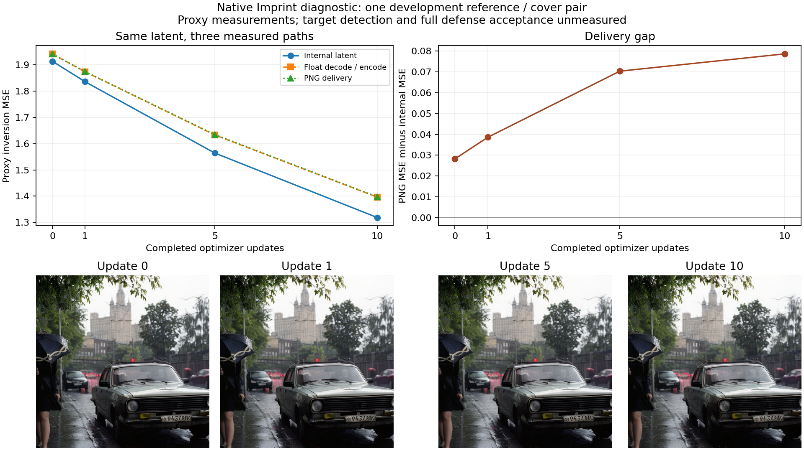

# 单对图片 Imprint 交付路径诊断

2026-10-18（Asia/Shanghai）。确定性修订版完成10次原生 Imprint 更新，四个预定检查点全部保存，退出码0。内部损失下降0.595194，PNG交付损失下降0.544701，保留约91.52%的内部改善。内部与交付差距随轨迹增大，但当前证据不支持将其直接认定为主要性能瓶颈。

## 实际测量

以下为已保存float32张量的CPU float64复算；原始GPU指标仍完整保留。

| 完成更新数 | 内部损失 | 浮点交付损失 | PNG交付损失 | PNG−内部 |
|---:|---:|---:|---:|---:|
| 0 | 1.913848 | 1.941262 | 1.942058 | 0.028210 |
| 1 | 1.836272 | 1.874131 | 1.874889 | 0.038617 |
| 5 | 1.564208 | 1.633115 | 1.634595 | 0.070387 |
| 10 | 1.318654 | 1.396448 | 1.397357 | 0.078703 |

内部改善与PNG改善之差为0.050492，约占内部改善8.48%。最终浮点与PNG损失之差仅0.000909；本对图片中，差距主要出现在浮点解码、范围截断与重新编码组成的路径上。该路径混合多个环节，不能单独归因于VAE，也不等于目标检测率下降。四个稀疏检查点之间的连线只帮助阅读，不代表逐步测量。

人工内容评审仍为0。助手查看四张真实输出图后观察到：均保留前景灰色汽车、湿街道、左侧伞与行人、树木和背景高楼，未见替换为参考茶壶场景；细节和色调略有变化。该观察不是盲法人工评分，content_pass与forgery_scope_pass仍为null。

## 固定条件与证据

- 参考图：阶段07 seed101的黄色茶壶水印图，SHA256 `0ae48a3bbc59ab76c7dbd246ad66cbda79e5f0abf88b4f0c13c598d10454d345`。
- Cover：官方 `images/car.png`，SHA256 `a0a8ed989979d6e55d73ee98201b6fb5ceabea4d1a79bdc5330a2d90f2b117c8`；水印阴性状态未检测。
- 代理：`Manojb/stable-diffusion-2-1-base@0094d483a120f3f33dafbd187ea4aa60d10de75c`；float32，512×512，DDIM反演50步，空提示词，guidance=1。
- 目标：官方原生潜变量MSE；Adam lr=0.01，seed201，10次更新，mask关闭。10步不是官方151步默认完整攻击复现。
- 上游：`ca68950cd7b53b8438a49580f134b2a0db28d778`；按SHA固定抽取四个helper定义，不修改上游，不导入目标验证模块。
- [冻结协议revision3](../../protocols/10_imprint_delivery_r3.json)，SHA256 `9738e115441be22edae76a28c7abb3e26133a43cdf7ea6bddf859fd0072145ef`。
- [完整原始run](../../runs/10_imprint_delivery_r3_20261017T185922Z/)、[53文件中转哈希](revision3_transfer.json)、[独立复算](analysis.json)。CPU复算与原始GPU指标最大绝对差1.4692e-7，符合预定读取容差。

本次GPU0执行569.237689408008秒，UUID绑定与三次空闲采样通过；无超时。保存参考的代理反演张量，以及每个检查点六份真实张量、PNG和哈希。该代理张量不是目标原始生成噪声。目标检测、完整几何接受和来源归属均未运行，保持null。

## 数值与记录核验

四个检查点的 DiffPipe/pipeline 反演通过atol=rtol=1e-5核对，内部反演重放均逐位相同。初始连续两次反向传播、插入记录操作前后反向传播均逐位相同。PNG保存重读像素一致，记录操作不更新z。候选按预定时刻固定哈希，无目标分数选择。

完整轨迹对照按[独立协议](../../protocols/10_imprint_shadow.json)完成，402.74117193883285秒，退出码0：保留相同初始化和10次更新，移除初始梯度探测与中间记录。包括最终z在内的六份路径张量、参考代理噪声和PNG共8个文件逐字节相同，最终指标一致，见[复核](shadow_verification.json)、[原始run](../../runs/10_imprint_shadow_20261017T190952Z/)及[中转清单](shadow_transfer.json)。这验证了本条固定轨迹，不能推广为所有配置的通用证明；对照不是新增独立攻击样本。

## 工程版本与原始失败

| 版本 | 实际结果 | 原始证据 |
|---|---|---|
| 原版 | 61.348秒后autograd.grad与reentrant checkpoint不兼容；0更新、0候选 | [run](../../runs/10_imprint_delivery_20261017T184646Z/) |
| revision2 | backward兼容修正通过11项CPU检查；运行54.173秒后梯度逐位检查失败，最大差3.0268e-9；0更新、1张初始化候选 | [run](../../runs/10_imprint_delivery_r2_20261017T185648Z/)、[21文件哈希](revision2_transfer.json) |
| revision3 | 明确确定性执行设置并加入无记录的连续反向对照；8项CPU契约检查通过；10更新完成 | [run](../../runs/10_imprint_delivery_r3_20261017T185922Z/) |

原失败代码、协议与结果均保留；不同数值执行设置的结果不假定逐位相同。revision2没有无记录的连续反向对照，无法仅凭它定位微小差异的来源。revision3通过两种梯度检查，与数值非确定性解释相容，但不反向改写revision2原因。

确定性设置依据[PyTorch 2.5.1文档](https://github.com/pytorch/pytorch/blob/v2.5.1/docs/source/notes/randomness.rst)：关闭benchmark与启用确定性算子是不同设置；这里使用确定性算法、cuDNN确定性和cuBLAS工作空间，遇不支持算子即报错。这不保证跨版本或跨平台可复现。

## 科学解释与下一项工作

H1在这一对图片、10次更新下获得描述性支持：内部改善大于交付改善；同时91.52%的改善仍保留，量化差异占比较小。没有总体统计推断、优化干预、跨模型收益或新颖性证明。完整防御材料缺失仍不能由这些分数替代。

完整轨迹对照通过后，下一项冻结两个固定点（初始化及更新10）的内部/浮点交付梯度和固定中心差分探测，判断优化方向是否存在值得干预的偏差。只降低代理损失不构成新攻击贡献；后续若有干预，必须同时计入图像内容、额外计算和真实目标端点。

资源范围仍为249物理0–2的空闲单卡、串行、UUID绑定、新增文件10GiB、无新模型下载。用户取消GPU时间授权上限，实际用量仍逐进程记账，固定协议保留1200秒故障保护。自主接续每30分钟检查真实状态，避免重复启动。

实际累计用量已从服务器15份execution逐一核对哈希并重新求和：1845.121920349542 GPU进程秒，含2次非零退出；这是从阶段07起的进程墙钟记录，不是成功样本数或GPU核函数计时。见[账本](../research_execution_ledger.json)。
