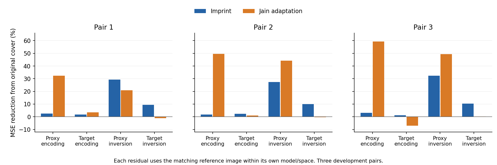

# 固定候选的目标编码定位

阶段19完成了12张固定图片的官方目标VAE编码。结果将阶段18的排序差异定位为多种情况：任务3在目标编码处已出现MSE和余弦的排序反转；任务2在编码处只有MSE排序反转，方向排序到反演后才反转。不能把这组观察统一归因为VAE，也不能统一归因为反演。

## 成对结果

下表的“领先方法”分别指更低MSE/更高余弦；参考为对应模型对同一参考图的表示。

|任务|代理编码z0|目标编码z0|代理反演zT|目标反演zT|
|---|---|---|---|---|
|1|Jain / Jain|Jain / Jain|Imprint / Imprint|Imprint / Imprint|
|2|Jain / Jain|Imprint / Jain|Jain / Jain|Imprint / Imprint|
|3|Jain / Jain|Imprint / Imprint|Jain / Jain|Imprint / Imprint|

任务1在两个模型内均由编码阶段的Jain领先变成反演阶段的Imprint领先。任务2的目标编码余弦仍由Jain略高（0.103277 vs 0.097758），反演后则是Imprint更高（0.106269 vs 0.077207）。任务3的目标编码余弦已是Imprint更高（0.087213 vs 0.066019）。

图中每根柱子都是在**自己的模型与表示空间**内，相对原载体误差的下降比例；负值表示比原载体更远。它不比较不同模型的绝对MSE，不表示因果传递比例。

Jain三对PNG在代理编码空间的MSE下降为32.44%/49.47%/59.39%，对应目标编码空间为3.43%/0.93%/−6.94%。代理编码改善没有按同样程度出现在目标编码空间。与此同时，Imprint目标编码改善只有1.82%/2.33%/1.27%，目标反演改善却为9.36%/10.06%/10.40%；编码接近程度不足以直接决定反演接近程度。

## 实际执行与核验

协议和代码在提交`4e38930`冻结，协议SHA256为`a1542696a61fcbaa99caebb4da6cde3bc01fb4aa3c776c006535907589fddd1e`。固定模型是SDXL revision `462165984030d82259a11f4367a4eed129e94a7b`，FP32、RGB 512×512、官方`provider.imgs_to_latents`。实际scaling_factor为0.13025。

输入为阶段17全部三组参考、载体、Imprint和Jain，沿用候选封存与完整队列。启动前五项CPU契约测试通过；提取官方预处理函数，以不含模型的编码stub检查12张实际图片，确认直接编码入口与反演入口的编码路径一致。该CPU检查不冒充真实VAE数值等价试验。

GPU0绑定已核对UUID后运行一个模型进程，退出0，用时15.559653秒。加载同一官方目标pipeline但只调用12次VAE编码；新生成、反演、优化及候选图片均为0。启动日志中的scheduler和safety_checker未使用参数提示保留，当前路径没有执行scheduler步骤。

21份运行文件传输哈希一致。CPU分析核对12份新编码与36份既有表示、图片绑定、候选封存、退出码、完成标志和参数；另以尺度/方向恒等式检查度量代码。图由已核验JSON通过Matplotlib绘制，PNG与SVG均保存并检查可读性。单图`encoding_seconds`包含编码结果导出开销，资源统计以完整进程execution为准。

阶段07起32个真实模型进程共5428.922686363570秒，32份execution与服务器逐一核对。结束核查无GPU计算进程；研究文件保守总量约196.8MiB，低于10GiB上限。

## 解释边界与已有研究

这是固定候选在不同表示路径上的事后定位。三对属于开发样本，方法的变量空间、优化器、损失与预算同时不同；没有进行只替换单组件的干预。因此“排序在某一步已出现”不等于该组件是唯一原因。目标编码和分析结果属于评估端，没有传给攻击算法。完整几何/SemBind接受、独立人工内容标签与新方法收益仍unknown。

Jain论文已讨论代理VAE并在SD1.4/SD2.0上报告实验，附录还包含DCT高频约束及相应比较。其15,000次迭代与本项目447步、SD2.1→SDXL适配不同；当前结果不反驳原论文设置，单纯频域限制也不能视作新增方法贡献。[论文v1：§5、§8.2、§11.3](https://arxiv.org/html/2504.20111v1)

本次公开元数据检查中，arXiv提交历史仅列v1；原SD2模型的Hugging Face页面返回401。原论文两个VAE的具体权重关联仍unknown，不据模型名称或相似架构推断其编码器相同或不同，未尝试绕过访问限制。[版本记录](https://arxiv.org/abs/2504.20111)

## 研究决策

这组三对、六候选的组件定位到此闭合，不继续添加同组微小扰动探测来寻找预期解释。下一项转为方法契约与新颖性核查：确定攻击侧能够计算的跨模型稳定性约束，明确其区别于既有VAE匹配、频域限制及交付一致性；只有形成可证伪机制和公平消融设计后，才冻结新的独立实验组。现有目标结果用于研究解释，不用于修改这些候选或筛选最好参数。

[完整数值](analysis.json) / [CPU入口核查](remote_preparation.json) / [文件清单](transfer.json) / [执行核对](execution_recheck.json) / [SVG图](representation_comparison.svg)
