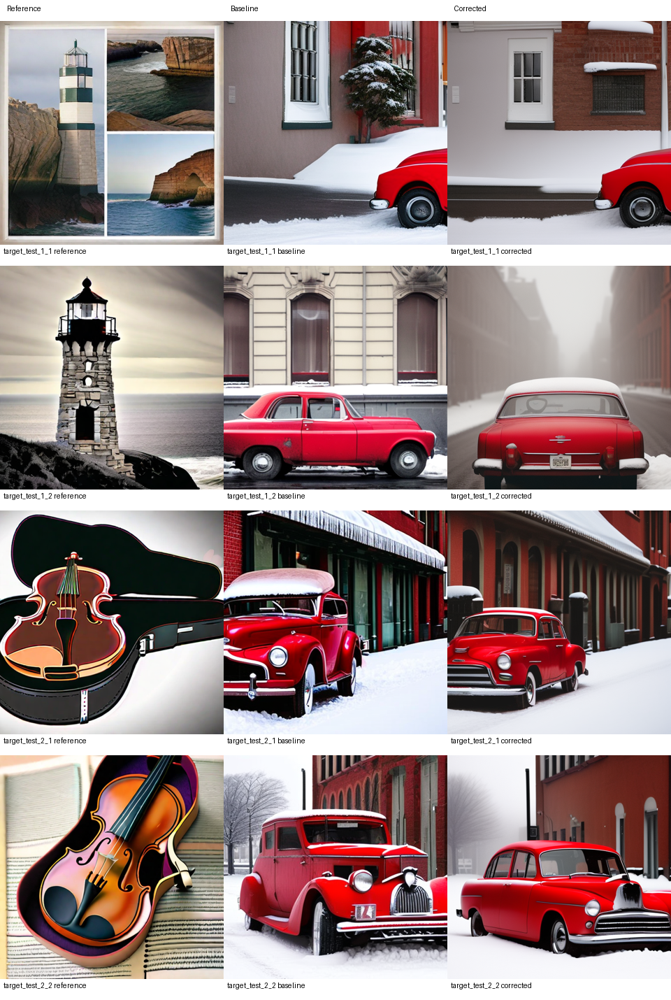

# 阶段25：固定校正的配对图像交付

阶段25配对交付已完成：原始/校正输出的目标消息准确率均值为0.93701172/0.88281250，平均下降5.419922个百分点；7/8下降、1/8持平、0/8改善。普通GS两组均8/8通过，参考图均1.0。24份分数由独立解码复核，16候选均先封存后评估。该固定映射按预先规定关闭；参考潜变量收益没有传递为交付收益。4进程381.006393秒全部正常退出，累计60进程7251.676560秒，无活动模型进程。

## 科学问题与固定比较

阶段24的代理监督线性映射改善了8张SDXL参考的坐标位恢复；本组检验这一固定收益是否经过代理生成与目标图像反演后保留。使用全部8张既有参考，每张产生原始和校正两个候选。共同提示词为“A photograph of a red vintage car parked on a snowy street.”，各对共享种子25001–25008。

代理为Manojb/stable-diffusion-2-1-base，revision0094d483a120f3f33dafbd187ea4aa60d10de75c；目标为stabilityai/stable-diffusion-xl-base-1.0，revision462165984030d82259a11f4367a4eed129e94a7b。使用现有本地快照、512、FP32，官方DDIM生成50步CFG7.5，目标反演50步空提示词CFG1。输入来自保存PNG的代理反演；这是PNG交付版Reprompting对照，与上游直接浮点张量路径的区别见[契约](../../docs/DELIVERY_TRANSFER_CONTRACT.md)。

主要端点为全部8对校正减原始的目标消息准确率均值。普通GS严格`>0.70703125`另报；参考有效子集不改变主要分母。输入FP32转换零符号变化，配对生成前Python/numpy/torch/CUDA随机状态核对相同。16候选与8参考于2026-10-18T05:39:55.365692Z整体封存，两个目标评估进程均在其后启动。攻击端未读取目标私有状态或分数，未改变估计器。共享OS用户不构成权限隔离。

## 原始检测结果

| 样本 | 参考消息准确率 | 原始输出 | 校正输出 | 校正减原始（百分点） |
|---|---:|---:|---:|---:|
| target_test_1_1 | 1.000000 | 0.957031 | 0.921875 | -3.5156 |
| target_test_1_2 | 1.000000 | 0.941406 | 0.851562 | -8.9844 |
| target_test_2_1 | 1.000000 | 0.914062 | 0.863281 | -5.0781 |
| target_test_2_2 | 1.000000 | 0.925781 | 0.828125 | -9.7656 |
| target_test_3_1 | 1.000000 | 0.933594 | 0.890625 | -4.2969 |
| target_test_3_2 | 1.000000 | 0.937500 | 0.890625 | -4.6875 |
| target_test_4_1 | 1.000000 | 0.964844 | 0.894531 | -7.0312 |
| target_test_4_2 | 1.000000 | 0.921875 | 0.921875 | +0.0000 |

均值为0.93701172→0.88281250，配对差-0.05419921875。四个参考提示词组均值差分别为-6.2500、-7.421875、-4.4921875、-3.515625个百分点。所有参考通过，次要有效参考子集与全组相同。两组候选各8/8通过普通GS，故这一阈值下的二值计数没有区分分数下降；8/8是本组计数，不能解释为总体攻击成功率。

## 实际图像观察

助手查看了全部24张图组成的两张联系表，观察到16候选均包含红色复古外观汽车和积雪，主体与参考中的灯塔、小提琴、铅笔和斑马不同；像素核验也确认所有候选均不等于参考图。`target_test_1_1`两种输出都只显示边缘处部分车身；`target_test_3_2`和`target_test_4_1`的校正输出呈树木/林地背景，街道条件不如其他样本明确。车辆构型、裁切和写实程度存在差异，不能据此给出正式内容达成率。

参考图本身也有提示词偏差：`target_test_1_1`为灯塔/海岸拼贴；`target_test_3_2`为重复铅笔图案而非明确的玻璃罐；`target_test_4_1`为重复斑马图案而非草地上的单一场景。`target_test_2_2`和`target_test_4_2`分别是小提琴、斑马近景。它们全部保留在计划分母中。这些是助手对真实图片的可见观察，独立人工评审仍为0份。

## 核验和资源

11项CPU接口检查在本机与249通过。274份阶段24源证据、16份潜变量转换、24张PNG、24份目标反演、配对随机状态和全部输入/候选关联均已复核。服务器以独立CDF量化、ChaCha20和严格多数投票重算24份官方分数；本机读回复核一致。225份证据完整传回，原始run约18.00MB；私有消息/key/nonce留在服务器。

4个模型进程均在249物理GPU0（UUID GPU-aafaf524-a6f4-f646-a2b5-7d243e80c8a5）串行执行，每次通过三次空闲采样及导入前复核。生成批次60.722293/61.052759秒，评估批次130.873350/128.357992秒，总计381.006393进程秒，均退出0；这是含加载的模型进程墙钟时间。前置阶段24另用581.474425秒，两个阶段合计962.480818秒；不能把本组生成耗时当作全部研究成本。最新全项目受计数目录约317.21MB，累计60进程7251.676560秒。

[实际结果](../../runs/25_delivery_transfer_20261018T053630Z/results.json) / [独立复核](verification.json) / [本机读回](local_readback.json) / [进程与哈希复查](execution_recheck.json) / [机器状态](status.json) / [科学协议](../../protocols/25_delivery_design.json)。

## 科学判断和后续

这是同一固定映射在已观察的8参考、4参考提示词组和1输出提示词上的配对开发反例：参考噪声MSE/坐标位恢复改善不保证最终目标消息准确率提高。它没有证明所有代理监督都无效，也没有识别幅值、符号、图像改变或目标反演各自的因果贡献。完整几何/SemBind接受、总体攻击率、独立人工内容标签均保持unknown。

预先规定的主要端点为非正，故该固定映射关闭，保留全部输出和失败方向。建立包含生成与反演的代理端交付目标契约，先静态核查它与已有Imprint、Jain及解码等价目标的实质区别；该固定线性映射关闭，不再调参或补样。
