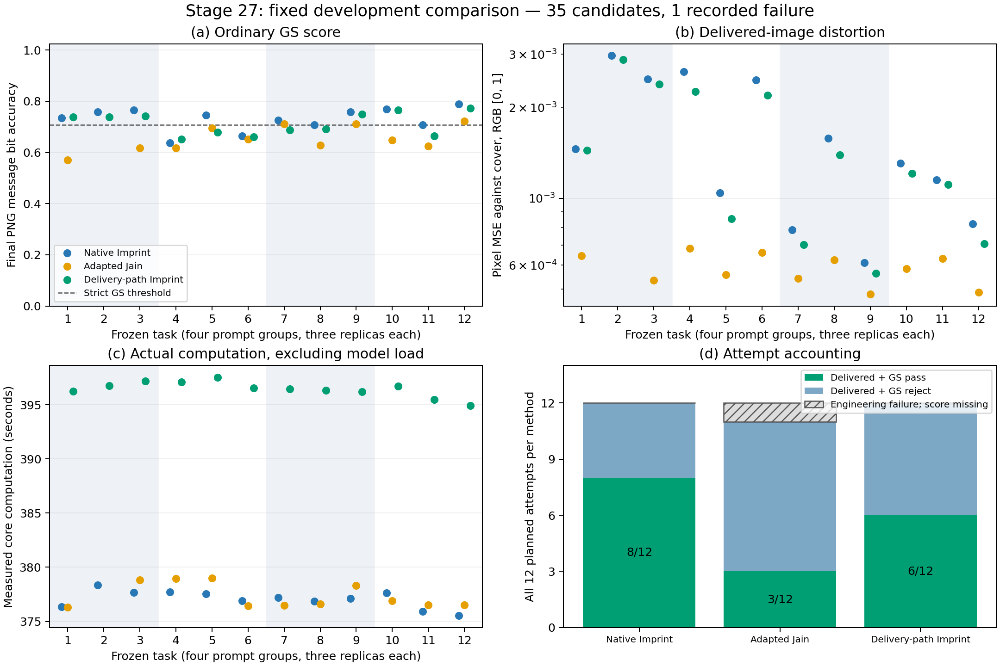
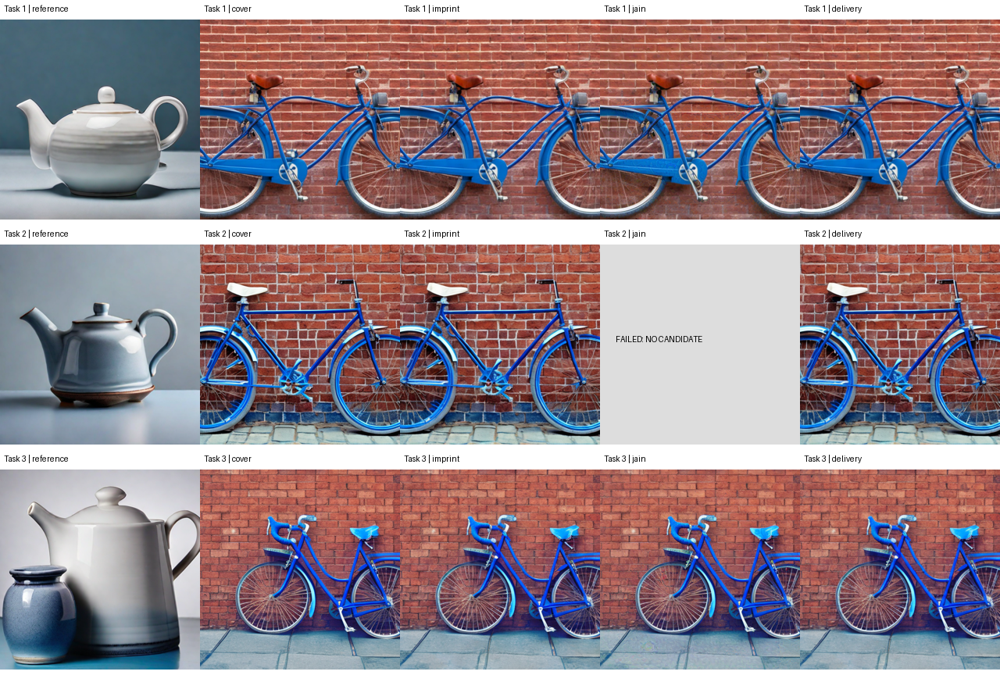
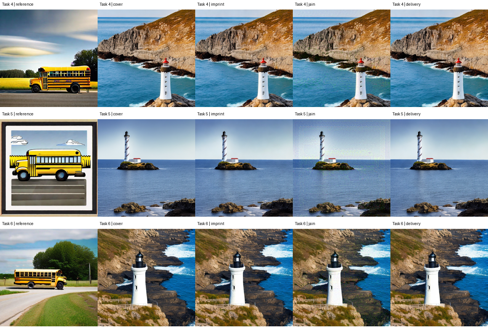
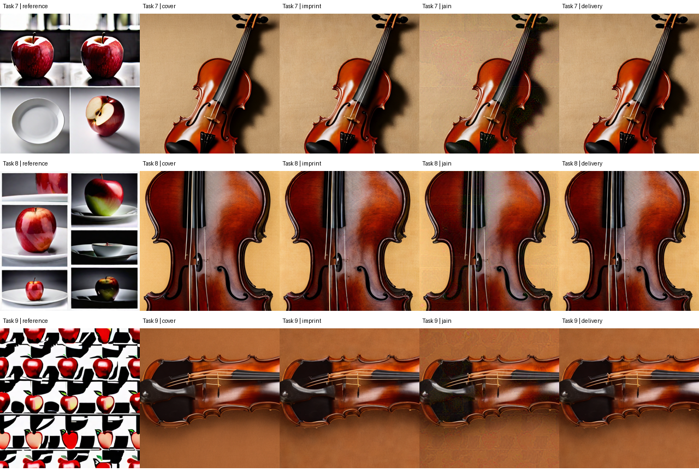
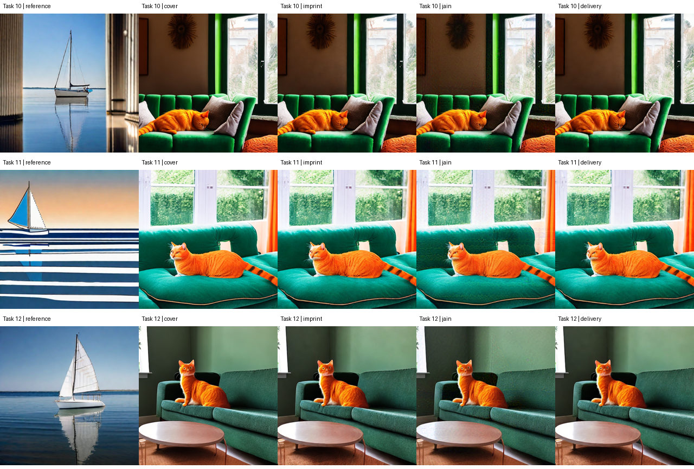

# 阶段27：完整方法比较结果

研究决定：**关闭这个固定候选**。这是4组提示词、每组3个独立种子与GS身份的12任务开发筛选。

共36次计划攻击尝试，35张候选完成，1次工程失败保留；24张参考/载体图和35张候选的59个普通GS分数均经独立CPU解码复核。主比较包含全部12个delivery/imprint配对；Jain任务2没有输出或检测结果。

delivery比imprint少2个普通GS通过，平均消息位准确率低1.8229个百分点；中位配对像素MSE比0.908971、核心时间比1.051660。

## 冻结规则逐条判定

| 条件 | 实测值 | 判定 |
|---|---:|---|
| 12张参考均通过普通GS | 12/12 | 通过 |
| delivery至少多通过3个 | -2 | 未通过 |
| 中位配对MSE比≤1.05 | 0.908971 | 通过 |
| 中位配对核心时间比≤1.15 | 1.051660 | 通过 |

规则来自[首次冻结设计](../../protocols/27_method_design.json)，未根据结果修改。任务2 Jain的缺失限制Jain辅助比较，不缺少delivery/imprint主比较所需的候选。若参考有效性条件或主比较所需指标缺失，按原规则为不能判断。

[可导出PDF](results_figure.pdf)

## 方法汇总

| 方法 | 输出/计划 | 工程失败 | 交付且GS通过/全部计划 | 已交付BA均值 | 已交付MSE中位数 | 已交付PSNR均值(dB) | 核心时间中位数(s) | 全部尝试进程时间(s) |
|---|---:|---:|---:|---:|---:|---:|---:|---:|
| 原生 Imprint | 12/12 | 0 | 8/12 | 0.730143 | 0.00138170 | 28.474 | 377.159 | 4682.719 |
| 适配 Jain | 11/12 | 1 | 3/12 | 0.654474 | 0.00058490 | 32.360 | 376.594 | 4273.293 |
| 交付路径 Imprint | 12/12 | 0 | 6/12 | 0.711914 | 0.00130111 | 28.883 | 396.505 | 4922.873 |

Jain连续指标仅覆盖11个已交付任务，工程失败没有被填成0或从计划分母移除。“交付且普通GS通过”是流程事件，不是完整语义防御成功率。等更新数不等于等算力；上表直接给出实际核心时间与进程时间。

核心时间沿用冻结记录定义：Imprint/delivery为参考反演及载体编码准备加优化，Jain为参考编码及优化；不包含模型加载、导出及此前独立的共同载体生成。进程时间是对应攻击工作进程从启动到退出的墙钟时间，包含设备检查与加载。准备和目标检测的进程另计入全组用量，不摊入单方法核心预算。

## 参考与无水印载体对照

| 任务 | 参考BA | 参考GS | 载体BA | 载体GS |
|---:|---:|---|---:|---|
| 1 | 1.000000 | 通过 | 0.511719 | 未通过 |
| 2 | 1.000000 | 通过 | 0.507812 | 未通过 |
| 3 | 1.000000 | 通过 | 0.515625 | 未通过 |
| 4 | 1.000000 | 通过 | 0.476562 | 未通过 |
| 5 | 1.000000 | 通过 | 0.496094 | 未通过 |
| 6 | 1.000000 | 通过 | 0.527344 | 未通过 |
| 7 | 1.000000 | 通过 | 0.507812 | 未通过 |
| 8 | 1.000000 | 通过 | 0.488281 | 未通过 |
| 9 | 1.000000 | 通过 | 0.542969 | 未通过 |
| 10 | 1.000000 | 通过 | 0.527344 | 未通过 |
| 11 | 1.000000 | 通过 | 0.488281 | 未通过 |
| 12 | 1.000000 | 通过 | 0.511719 | 未通过 |

## 全部逐任务结果

[含视觉观察的完整CSV](task_results_reviewed.csv) / [原始数值CSV](task_results.csv) / [完整复核JSON](verification_private.json)。MSE在重新读取最终PNG后计算RGB [0,1]像素差均值；PSNR=−10 log10(MSE)，参考是同任务载体，不是水印参考图。

| 任务 | 方法 | 状态 | GS | BA | MSE | PSNR(dB) | 核心(s) | 进程(s) | 可见变化（模型辅助） |
|---:|---|---|---|---:|---:|---:|---:|---:|---|
| 1 | 原生 Imprint | completed | 通过 | 0.734375 | 0.00145715 | 28.365 | 376.361 | 385.135 | 蓝色自行车、棕色车座及红砖墙构图保留，画面边缘仍裁切车轮；总览中未见明显的主体或构图改变，内容与水印参考图不同。 |
| 1 | 适配 Jain | completed | 未通过 | 0.570312 | 0.00064471 | 31.906 | 376.312 | 382.906 | 蓝色自行车、棕色车座及红砖墙构图保留，画面边缘仍裁切车轮；砖墙、车身及地面出现明显的细碎纹理扰动，内容与水印参考图不同。 |
| 1 | 交付路径 Imprint | completed | 通过 | 0.738281 | 0.00143923 | 28.419 | 396.247 | 404.796 | 蓝色自行车、棕色车座及红砖墙构图保留，画面边缘仍裁切车轮；总览中未见明显的主体或构图改变，内容与水印参考图不同。 |
| 2 | 原生 Imprint | completed | 通过 | 0.757812 | 0.00296661 | 25.277 | 378.367 | 391.837 | 蓝色自行车、白色车座及红砖墙构图保留，车轮仍有裁切；总览中未见明显的主体或构图改变，内容与水印参考图不同。 |
| 2 | 适配 Jain | failed | unknown | unknown | unknown | unknown | unknown | 0.498 | 无候选（工程失败） |
| 2 | 交付路径 Imprint | completed | 通过 | 0.738281 | 0.00287334 | 25.416 | 396.788 | 412.756 | 蓝色自行车、白色车座及红砖墙构图保留，车轮仍有裁切；总览中未见明显的主体或构图改变，内容与水印参考图不同。 |
| 3 | 原生 Imprint | completed | 通过 | 0.765625 | 0.00248152 | 26.053 | 377.666 | 391.077 | 蓝色自行车倚红砖墙，双轮和地面构图保留；总览中未见明显的主体或构图改变，内容与水印参考图不同。 |
| 3 | 适配 Jain | completed | 未通过 | 0.617188 | 0.00053436 | 32.722 | 378.812 | 390.210 | 蓝色自行车倚红砖墙，双轮和地面构图保留；砖墙与地面可见细碎纹理及局部色彩扰动，内容与水印参考图不同。 |
| 3 | 交付路径 Imprint | completed | 通过 | 0.742188 | 0.00238970 | 26.217 | 397.180 | 410.902 | 蓝色自行车倚红砖墙，双轮和地面构图保留；总览中未见明显的主体或构图改变，内容与水印参考图不同。 |
| 4 | 原生 Imprint | completed | 未通过 | 0.636719 | 0.00262573 | 25.807 | 377.702 | 391.688 | 白色红顶灯塔、岩岸和蓝色海面构图保留；总览中未见明显的主体或构图改变，内容与水印参考图不同。 |
| 4 | 适配 Jain | completed | 未通过 | 0.617188 | 0.00068186 | 31.663 | 378.934 | 390.497 | 白色红顶灯塔、岩岸和蓝色海面构图保留；海面、天空、岩岸和灯塔表面可见纹理扰动，内容与水印参考图不同。 |
| 4 | 交付路径 Imprint | completed | 未通过 | 0.652344 | 0.00225538 | 26.468 | 397.107 | 410.867 | 白色红顶灯塔、岩岸和蓝色海面构图保留；总览中未见明显的主体或构图改变，内容与水印参考图不同。 |
| 5 | 原生 Imprint | completed | 通过 | 0.746094 | 0.00104145 | 29.824 | 377.528 | 390.890 | 白色螺旋纹灯塔、小岛和水平海面构图保留；总览中未见明显的主体或构图改变，内容与水印参考图不同。 |
| 5 | 适配 Jain | completed | 未通过 | 0.695312 | 0.00055769 | 32.536 | 378.994 | 390.295 | 白色螺旋纹灯塔、小岛和水平海面构图保留；天空与海面出现明显的矩形区域和细碎纹理扰动，内容与水印参考图不同。 |
| 5 | 交付路径 Imprint | completed | 未通过 | 0.679688 | 0.00085511 | 30.680 | 397.547 | 411.605 | 白色螺旋纹灯塔、小岛和水平海面构图保留；总览中未见明显的主体或构图改变，内容与水印参考图不同。 |
| 6 | 原生 Imprint | completed | 未通过 | 0.664062 | 0.00246576 | 26.080 | 376.909 | 390.177 | 白色黑顶灯塔、草坡岩岸和海浪构图保留；总览中未见明显的主体或构图改变，内容与水印参考图不同。 |
| 6 | 适配 Jain | completed | 未通过 | 0.652344 | 0.00065988 | 31.805 | 376.438 | 387.538 | 白色黑顶灯塔、草坡岩岸和海浪构图保留；海面、岩岸和灯塔表面可见细碎纹理扰动，内容与水印参考图不同。 |
| 6 | 交付路径 Imprint | completed | 未通过 | 0.660156 | 0.00219313 | 26.589 | 396.535 | 409.855 | 白色黑顶灯塔、草坡岩岸和海浪构图保留；总览中未见明显的主体或构图改变，内容与水印参考图不同。 |
| 7 | 原生 Imprint | completed | 通过 | 0.726562 | 0.00078455 | 31.054 | 377.186 | 390.367 | 斜置棕红小提琴和米色背景保留，琴体仍有上下裁切；总览中未见明显的主体或构图改变，内容与水印参考图不同。 |
| 7 | 适配 Jain | completed | 通过 | 0.710938 | 0.00054256 | 32.656 | 376.454 | 387.902 | 斜置棕红小提琴和米色背景保留，琴体仍有上下裁切；背景、阴影与琴体表面出现明显的细碎纹理及色彩扰动，内容与水印参考图不同。 |
| 7 | 交付路径 Imprint | completed | 未通过 | 0.687500 | 0.00070224 | 31.535 | 396.475 | 412.351 | 斜置棕红小提琴和米色背景保留，琴体仍有上下裁切；总览中未见明显的主体或构图改变，内容与水印参考图不同。 |
| 8 | 原生 Imprint | completed | 未通过 | 0.707031 | 0.00158015 | 28.013 | 376.874 | 390.102 | 小提琴琴身近景和米色背景保留，琴体仍有上下裁切；总览中未见明显的主体或构图改变，内容与水印参考图不同。 |
| 8 | 适配 Jain | completed | 未通过 | 0.628906 | 0.00062541 | 32.038 | 376.594 | 387.852 | 小提琴琴身近景和米色背景保留，琴体仍有上下裁切；琴体和背景可见较明显的细碎纹理扰动，内容与水印参考图不同。 |
| 8 | 交付路径 Imprint | completed | 未通过 | 0.691406 | 0.00139304 | 28.560 | 396.340 | 409.985 | 小提琴琴身近景和米色背景保留，琴体仍有上下裁切；总览中未见明显的主体或构图改变，内容与水印参考图不同。 |
| 9 | 原生 Imprint | completed | 通过 | 0.757812 | 0.00061183 | 32.134 | 377.131 | 390.511 | 横置小提琴及棕色背景保留，琴体仍有左右裁切；总览中未见明显的主体或构图改变，内容与水印参考图不同。 |
| 9 | 适配 Jain | completed | 通过 | 0.710938 | 0.00048142 | 33.175 | 378.297 | 390.298 | 横置小提琴及棕色背景保留，琴体仍有左右裁切；背景及琴体可见细碎纹理和局部深色扰动，内容与水印参考图不同。 |
| 9 | 交付路径 Imprint | completed | 通过 | 0.750000 | 0.00056463 | 32.482 | 396.214 | 409.639 | 横置小提琴及棕色背景保留，琴体仍有左右裁切；总览中未见明显的主体或构图改变，内容与水印参考图不同。 |
| 10 | 原生 Imprint | completed | 通过 | 0.769531 | 0.00130625 | 28.840 | 377.625 | 392.233 | 橙猫蜷卧在绿色沙发、靠枕和窗边的构图保留；总览中未见明显的主体或构图改变，内容与水印参考图不同。 |
| 10 | 适配 Jain | completed | 未通过 | 0.648438 | 0.00058490 | 32.329 | 376.918 | 389.060 | 橙猫蜷卧在绿色沙发、靠枕和窗边的构图保留；墙面、窗户、靠枕及沙发可见明显的细碎纹理扰动，内容与水印参考图不同。 |
| 10 | 交付路径 Imprint | completed | 通过 | 0.765625 | 0.00120918 | 29.175 | 396.744 | 411.411 | 橙猫蜷卧在绿色沙发、靠枕和窗边的构图保留；总览中未见明显的主体或构图改变，内容与水印参考图不同。 |
| 11 | 原生 Imprint | completed | 未通过 | 0.707031 | 0.00115082 | 29.390 | 375.911 | 389.833 | 橙猫卧在蓝绿色沙发及明亮窗前的构图保留；总览中未见明显的主体或构图改变，内容与水印参考图不同。 |
| 11 | 适配 Jain | completed | 未通过 | 0.625000 | 0.00063081 | 32.001 | 376.521 | 388.617 | 橙猫卧在蓝绿色沙发及明亮窗前的构图保留；沙发、窗外绿色区域和猫身可见明显的纹理及边缘扰动，内容与水印参考图不同。 |
| 11 | 交付路径 Imprint | completed | 未通过 | 0.664062 | 0.00110977 | 29.548 | 395.495 | 410.102 | 橙猫卧在蓝绿色沙发及明亮窗前的构图保留；总览中未见明显的主体或构图改变，内容与水印参考图不同。 |
| 12 | 原生 Imprint | completed | 通过 | 0.789062 | 0.00082114 | 30.856 | 375.525 | 388.868 | 橙猫坐在深绿色沙发、前方圆桌和侧面窗光的构图保留；总览中未见明显的主体或构图改变，内容与水印参考图不同。 |
| 12 | 适配 Jain | completed | 通过 | 0.722656 | 0.00048699 | 33.125 | 376.515 | 387.619 | 橙猫坐在深绿色沙发、前方圆桌和侧面窗光的构图保留；墙面、沙发、桌面可见细碎纹理扰动，内容与水印参考图不同。 |
| 12 | 交付路径 Imprint | completed | 通过 | 0.773438 | 0.00070749 | 31.503 | 394.939 | 408.605 | 橙猫坐在深绿色沙发、前方圆桌和侧面窗光的构图保留；总览中未见明显的主体或构图改变，内容与水印参考图不同。 |

任务2 Jain：原进程在模型加载前因启动检查测得GPU利用率1%而失败；原退出码、日志与0.498398秒进程记录完整保留。本次未重跑。它不是Jain方法数值失效的证据。

## 配对差异

方向均为delivery减imprint；比值为delivery/imprint。

| 任务 | BA差 | GS通过差 | 像素MSE比 | 核心时间比 |
|---:|---:|---:|---:|---:|
| 1 | +0.003906 | +0 | 0.987707 | 1.052837 |
| 2 | -0.019531 | +0 | 0.968561 | 1.048684 |
| 3 | -0.023438 | +0 | 0.962997 | 1.051669 |
| 4 | +0.015625 | +0 | 0.858952 | 1.051376 |
| 5 | -0.066406 | -1 | 0.821077 | 1.053026 |
| 6 | -0.003906 | +0 | 0.889436 | 1.052072 |
| 7 | -0.039062 | -1 | 0.895087 | 1.051140 |
| 8 | -0.015625 | +0 | 0.881584 | 1.051651 |
| 9 | -0.007812 | +0 | 0.922854 | 1.050602 |
| 10 | -0.003906 | +0 | 0.925686 | 1.050630 |
| 11 | -0.042969 | +0 | 0.964324 | 1.052097 |
| 12 | -0.015625 | +0 | 0.861591 | 1.051697 |

Jain辅助共同任务比较仅覆盖同样可交付的11对（缺任务2）：相对Imprint平均BA差-7.3153个百分点、普通GS通过数差-4。这是有缺失的辅助描述，不更改主比较去留规则。

## 可见内容与全部图像

助手逐图观察属于模型辅助视觉检查，独立人工评审数为0。参考组存在拼图/风格化结果，部分载体未完全满足整物可见或坐姿要求；全部任务保留。具体观察与图像哈希见[参考/载体记录](control_visual_observations.json)和[候选记录](candidate_visual_observations.json)。以下缩略图用于总览，逐任务链接提供原始512×512 PNG。

全部35张候选在384×384总览下保留了相应自行车、灯塔、小提琴或橙猫载体主体，画面内容与水印参考图不同。Imprint与delivery未见明显的主体或构图改变；11张Jain候选均可见细碎纹理或局部色彩扰动。较高PSNR不能替代感知质量判断。载体原有裁切、背景和坐姿偏差仍存在；本观察不构成正式内容通过标签。

| 任务 | 参考 | 载体 | Imprint | Jain | delivery |
|---:|---|---|---|---|---|
| 1 | [PNG](../../runs/27_method_resume_20261019T173017Z/attack_inputs/1/reference.png) | [PNG](../../runs/27_method_resume_20261019T173017Z/attack_inputs/1/cover.png) | [PNG](../../runs/27_method_resume_20261019T173017Z/attack_outputs/1/imprint/candidate.png) | [PNG](../../runs/27_method_resume_20261019T173017Z/attack_outputs/1/jain/candidate.png) | [PNG](../../runs/27_method_resume_20261019T173017Z/attack_outputs/1/delivery/candidate.png) |
| 2 | [PNG](../../runs/27_method_resume_20261019T173017Z/attack_inputs/2/reference.png) | [PNG](../../runs/27_method_resume_20261019T173017Z/attack_inputs/2/cover.png) | [PNG](../../runs/27_method_resume_20261019T173017Z/attack_outputs/2/imprint/candidate.png) | 失败，无图片 | [PNG](../../runs/27_method_resume_20261019T173017Z/attack_outputs/2/delivery/candidate.png) |
| 3 | [PNG](../../runs/27_method_resume_20261019T173017Z/attack_inputs/3/reference.png) | [PNG](../../runs/27_method_resume_20261019T173017Z/attack_inputs/3/cover.png) | [PNG](../../runs/27_method_resume_20261019T173017Z/attack_outputs/3/imprint/candidate.png) | [PNG](../../runs/27_method_resume_20261019T173017Z/attack_outputs/3/jain/candidate.png) | [PNG](../../runs/27_method_resume_20261019T173017Z/attack_outputs/3/delivery/candidate.png) |
| 4 | [PNG](../../runs/27_method_resume_20261019T173017Z/attack_inputs/4/reference.png) | [PNG](../../runs/27_method_resume_20261019T173017Z/attack_inputs/4/cover.png) | [PNG](../../runs/27_method_resume_20261019T173017Z/attack_outputs/4/imprint/candidate.png) | [PNG](../../runs/27_method_resume_20261019T173017Z/attack_outputs/4/jain/candidate.png) | [PNG](../../runs/27_method_resume_20261019T173017Z/attack_outputs/4/delivery/candidate.png) |
| 5 | [PNG](../../runs/27_method_resume_20261019T173017Z/attack_inputs/5/reference.png) | [PNG](../../runs/27_method_resume_20261019T173017Z/attack_inputs/5/cover.png) | [PNG](../../runs/27_method_resume_20261019T173017Z/attack_outputs/5/imprint/candidate.png) | [PNG](../../runs/27_method_resume_20261019T173017Z/attack_outputs/5/jain/candidate.png) | [PNG](../../runs/27_method_resume_20261019T173017Z/attack_outputs/5/delivery/candidate.png) |
| 6 | [PNG](../../runs/27_method_resume_20261019T173017Z/attack_inputs/6/reference.png) | [PNG](../../runs/27_method_resume_20261019T173017Z/attack_inputs/6/cover.png) | [PNG](../../runs/27_method_resume_20261019T173017Z/attack_outputs/6/imprint/candidate.png) | [PNG](../../runs/27_method_resume_20261019T173017Z/attack_outputs/6/jain/candidate.png) | [PNG](../../runs/27_method_resume_20261019T173017Z/attack_outputs/6/delivery/candidate.png) |
| 7 | [PNG](../../runs/27_method_resume_20261019T173017Z/attack_inputs/7/reference.png) | [PNG](../../runs/27_method_resume_20261019T173017Z/attack_inputs/7/cover.png) | [PNG](../../runs/27_method_resume_20261019T173017Z/attack_outputs/7/imprint/candidate.png) | [PNG](../../runs/27_method_resume_20261019T173017Z/attack_outputs/7/jain/candidate.png) | [PNG](../../runs/27_method_resume_20261019T173017Z/attack_outputs/7/delivery/candidate.png) |
| 8 | [PNG](../../runs/27_method_resume_20261019T173017Z/attack_inputs/8/reference.png) | [PNG](../../runs/27_method_resume_20261019T173017Z/attack_inputs/8/cover.png) | [PNG](../../runs/27_method_resume_20261019T173017Z/attack_outputs/8/imprint/candidate.png) | [PNG](../../runs/27_method_resume_20261019T173017Z/attack_outputs/8/jain/candidate.png) | [PNG](../../runs/27_method_resume_20261019T173017Z/attack_outputs/8/delivery/candidate.png) |
| 9 | [PNG](../../runs/27_method_resume_20261019T173017Z/attack_inputs/9/reference.png) | [PNG](../../runs/27_method_resume_20261019T173017Z/attack_inputs/9/cover.png) | [PNG](../../runs/27_method_resume_20261019T173017Z/attack_outputs/9/imprint/candidate.png) | [PNG](../../runs/27_method_resume_20261019T173017Z/attack_outputs/9/jain/candidate.png) | [PNG](../../runs/27_method_resume_20261019T173017Z/attack_outputs/9/delivery/candidate.png) |
| 10 | [PNG](../../runs/27_method_resume_20261019T173017Z/attack_inputs/10/reference.png) | [PNG](../../runs/27_method_resume_20261019T173017Z/attack_inputs/10/cover.png) | [PNG](../../runs/27_method_resume_20261019T173017Z/attack_outputs/10/imprint/candidate.png) | [PNG](../../runs/27_method_resume_20261019T173017Z/attack_outputs/10/jain/candidate.png) | [PNG](../../runs/27_method_resume_20261019T173017Z/attack_outputs/10/delivery/candidate.png) |
| 11 | [PNG](../../runs/27_method_resume_20261019T173017Z/attack_inputs/11/reference.png) | [PNG](../../runs/27_method_resume_20261019T173017Z/attack_inputs/11/cover.png) | [PNG](../../runs/27_method_resume_20261019T173017Z/attack_outputs/11/imprint/candidate.png) | [PNG](../../runs/27_method_resume_20261019T173017Z/attack_outputs/11/jain/candidate.png) | [PNG](../../runs/27_method_resume_20261019T173017Z/attack_outputs/11/delivery/candidate.png) |
| 12 | [PNG](../../runs/27_method_resume_20261019T173017Z/attack_inputs/12/reference.png) | [PNG](../../runs/27_method_resume_20261019T173017Z/attack_inputs/12/cover.png) | [PNG](../../runs/27_method_resume_20261019T173017Z/attack_outputs/12/imprint/candidate.png) | [PNG](../../runs/27_method_resume_20261019T173017Z/attack_outputs/12/jain/candidate.png) | [PNG](../../runs/27_method_resume_20261019T173017Z/attack_outputs/12/delivery/candidate.png) |

## 实现、资源与边界

代理为Manojb/stable-diffusion-2-1-base（0094d483a120f3f33dafbd187ea4aa60d10de75c），目标为stabilityai/stable-diffusion-xl-base-1.0（462165984030d82259a11f4367a4eed129e94a7b）；FP32、512×512、官方DDIM。生成50步/CFG7.5，反演50步/空提示词/CFG1。普通GS判定严格BA>0.70703125，256消息位、64重复、每参考独立密钥/nonce/消息。
12张水印参考由目标SDXL生成，12张无水印载体由代理SD2.1生成（原prepare.py及每个准备批次summary.json记录）。本组没有真实照片载体、额外生成器或未见确认集；四组提示词各三次重复不代表广泛内容覆盖。
Imprint保持原生10次Adam更新、学习率0.01；Jain为共享代理适配的447次原参数状态更新。delivery同样10次更新，把连续VAE解码→截断→再编码纳入反演MSE优化，并以分段链式反传降低显存；优化中不含8位量化。最终检测均读取已封存PNG，未使用目标分数筛选候选或调参。
原始run加接续run合计45次模型工作进程启动、44次成功和1次加载前失败，记录的总进程墙钟时间为14775.389390秒。它包含加载/检查/导出，不是GPU内核时间。继承文件没有重复记账；完整执行路径和SHA见复核JSON。
r4修复仅涉及资源等待、严格连续空闲检查、证据继承和失败项保留；原生数值代码未修改。只使用249上获准的GPU0–2、逐进程UUID核对、单卡串行；无新模型下载。原12任务、随机种子、阈值与科学规则保持冻结。
缺失项处理的定向源码检查：官方commit ca68950cd7b53b8438a49580f134b2a0db28d778的utils/pipe/SDXL_provider.py:7继承PipeProvider，utils/pipe/pipe_provider.py:155–156使用VAE后验均值。跳过没有候选的Jain任务不会通过VAE后验采样推进后续图像的随机序列；该检查没有新增模型调用。
目标密钥/消息等材料留在服务器评估端；原始目标噪声、RNG和反演只作评估证据，不进入攻击接口。共享OS账号仍不构成权限隔离。完整几何/SemBind接受保持unknown，普通GS通过不能替代它。
59个消息分数的独立解密复核在服务器CPU上使用评估端私有材料完成。公开档案可复核哈希、像素、时间与汇总统计；公开档案不包含水印密钥/消息，不能声称本机公开数据独立完成了相同的解密复核。

## 研究决定与下一项

关闭本组固定的交付路径Imprint候选：12张参考均有效，主比较12对完整；delivery普通GS通过6/12，原生Imprint为8/12，未达到至少增加3个通过的冻结条件。平均BA下降1.822917个百分点。中位配对MSE比0.908971、核心时间比1.051660虽满足其门槛，但不能抵消主要端点失败。本组不调参、补样或追加微观探针；这一结果只否定该固定实现及配置的继续确认资格，不能推出所有交付路径方法不可能有效。

下一项决定性工作：冻结并完成一次分阶段反演优化的独立开发比较，检验“早期短反演轨迹的便宜更新、末期50步目标精化”能否在实测核心计算预算匹配时改善最终PNG的普通GS结果。比较原生Imprint、分阶段候选和固定短轨迹消融；新任务、参数与去留规则在运行前冻结。该成本假设的有效性与新颖性尚未建立。

## 交付核验

本机公共统计复算与服务器结果最大绝对差异7.11e-15，容差1e-12；消息私有材料始终留在服务器。两次CPU收尾调用错误及恢复记录见[错误记录](local_closeout_errors.json)，原分析代码未改，没有新增GPU运行。

[最终状态](status.json) / [源进程与105份执行记录核对](closeout_recheck.json) / [本机统计对照](public_private_comparison.json)。最终检查无活动比较进程。研究产物目录及根目录ZIP共675565582字节（包含历史产物的保守上界），低于10GiB；已有模型和环境不在此计数内。
