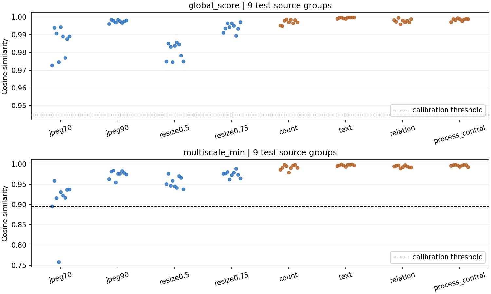
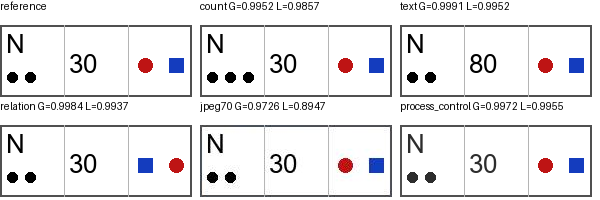

# CPU 子集实测：固定多尺度未分离构造事实修改

本轮新运行了真实 SSCD 特征提取，数据是 18 张已有许可照片上的人工绘制事实标记。结果支持停止把“全局改成简单 2×2 多尺度”当作已经有效的方案。这个构造控制实验尚不能支持自然图像语义攻击、生成实例认证或完整水印伪造的结论。

## 数据与冻结规则

本机已有20张 Commons 源照片、CLIP/SSCD/DINOv2权重。使用99 MB的既有SSCD权重，SHA-256与旧模型清单一致。stage03同提示词生成原图未在本机找到；没有访问远程计算，也没有下载模型。

打分前检查20张源图与事实标记，保守排除与另一保留图疑似同山景的 `commons_69468782`、`commons_69586487`，得到9校准/9测试。旧清单已排除的绘画也未纳入。保留旧源图分区，所有派生图按源图归属；这些源照片在旧工作中使用过，因此本次是探索性重用分区，不是新的未见分布或全新封存测试集。

每张512×512照片绘制固定192×72标记板，位置由源ID哈希确定，与图像和分数无关。原始事实为两个圆点、数字30、红圆在蓝方左侧；对应修改为三个圆点、数字80、左右交换。另用相同渲染流程将黑色改为深灰而保持事实，作为处理流程控制。标签来自可检查的绘制操作，Codex在打分前查看全部事实/允许编辑面板；这不是独立人类标注或自然场景编辑审核。

第一轮18×9=162张图，包括参考、JPEG70/90、resize0.5/0.75、三种修改及流程控制。不同源图替换使用同分区排序后循环的下一张参考，属于容易的源图替换控制，不能代替同提示词不同种子冒认。全部原图哈希、许可、作者、来源链接、分区和派生图标签见 [sources.json](../reports/cpu_pilot/sources.json)、[manifest.json](../reports/cpu_pilot/manifest.json)。

| 阶段/计数 | 本次实际范围 |
|---|---|
| 原计划48个生成源、16/16/16 | 仍待执行；本轮没有把照片子集计为该计划完成 |
| 本机候选许可照片 | 20个源；无生成prompt族，按源ID和打分前场景检查分组 |
| 打分前排除 | 2个疑似共享山景源，ID见上；此前被排除的绘画不属于这20个候选 |
| 有效源 | 18=9校准+9测试；没有开发集、没有用测试结果改模型或阈值 |
| 第一轮图像 | 162有效，生成/提取失败0；含18个新绘制参考及144个派生变体 |
| 处理匹配复核 | 108有效，失败0；仍用同18个源和原冻结阈值 |
| 测试分母 | 4允许变换×9源=36；count/text/relation各9，三类来自同9源，不能相加当27个独立源 |
| 本轮未覆盖 | 原48生成源队列、同prompt替代、自然语义编辑和完整水印验证；不把差额28描述为该照片队列缺失样本 |

原48源计划的内容表示筛查与完整防御阶段分别有Go门槛。本次有限控制诊断不满足进入完整防御或训练新方法的证据门槛；处理匹配与网格定位只解释固定方法的表现。后续若改尺度/池化/编码器，须新建开发集并另留未用测试集。

## 方法与资源

同一SSCD、同一RGB/320×320 bilinear/归一化和float32余弦；global使用全图，multiscale取全图及固定2×2网格同位置余弦的最小值。两法均有完整参考访问；改动框只用于制图和验证标签，不输入评分。多尺度存储五份512维向量：10,240 B/参考，global为2,048 B。多尺度同时需要五个视图的编码，不能把它当作等计算/等存储改进。

CPU 2线程，162图×5视图在141.4秒内完成；重复提取最大差异0。该时间是共同五视图管线总耗时，不是分别测量两法延迟。首次加载因TorchScript中文路径失败，改文件流后继续，失败日志与打分前兼容性修订记录均保留。

阈值仅由校准源图36个允许变换分数拟合，接受条件为score≥threshold；目标FRR=5%，离散阶统计实际两法均接受35/36（97.22%）。global阈值0.944653690，multiscale阈值0.893973589。没有测试阈值调优；以下测试正常接受率并不完全相等。

## 第一轮结果

| 测试类别 | Global接受 | 固定多尺度接受 |
|---|---:|---:|
| JPEG70 | 9/9 | 8/9 |
| JPEG90 | 9/9 | 9/9 |
| resize0.5 | 9/9 | 9/9 |
| resize0.75 | 9/9 | 9/9 |
| 允许编辑合计 | 36/36 | 35/36 |
| 圆点计数2→3 | 9/9 | 9/9 |
| 数字30→80 | 9/9 | 9/9 |
| 红圆/蓝方左右交换 | 9/9 | 9/9 |
| 同事实渲染控制 | 9/9 | 9/9 |
| 不同源图替换 | 0/9 | 0/9 |

每类每源数量相同，source-macro与表内比例一致。按源图配对重采样2,000次、分别重采校准/测试源且每次重拟合阈值，多尺度减global的允许编辑接受差为−2.78个百分点，探索性95%区间为[−16.67,0]个百分点。三个修改类别差为0且区间退化；不能由此推断总体差异严格为零。9个源组不足以估计可靠低误差率，替换控制还依赖固定供体图。

这些图例只显示项目自行绘制的标记板。分数图包含全部9个测试源组；实例替换的低分单独列在原始CSV及表中。全局和多尺度都把标记修改判为相似，但多尺度额外拒绝一个合法JPEG70，当前没有正收益证据。

## 处理匹配复核：沿用原阈值

看到第一轮结果后另冻结 [复核配置](../configs/cpu_followup.json)，对全部三类修改分别施加同样的JPEG70和resize0.5，新增108张真实处理图，CPU耗时92.6秒。阈值保持原值；这一步明确是事后机制诊断，不是独立确认实验。

| 测试修改及后处理 | Global接受 | 固定多尺度接受 | 相同后处理的合法图接受（global / 多尺度） |
|---|---:|---:|---:|
| count + JPEG70 | 9/9 | 7/9 | 9/9 / 8/9 |
| text + JPEG70 | 9/9 | 8/9 | 9/9 / 8/9 |
| relation + JPEG70 | 9/9 | 8/9 | 9/9 / 8/9 |
| count + resize0.5 | 9/9 | 9/9 | 9/9 / 9/9 |
| text + resize0.5 | 9/9 | 9/9 | 9/9 / 9/9 |
| relation + resize0.5 | 9/9 | 9/9 | 9/9 / 9/9 |

text/relation的JPEG拒绝与匹配合法图逐源判定完全一致；count仅多拒绝一个源图。不能把共同的JPEG拒绝都归因于识别出了事实修改。处理匹配后大部分修改仍被接受，当前证据仍不支持简单多尺度收益。[原始复核分数](../reports/cpu_pilot/followup/scores.csv)与[逐源配对指标](../reports/cpu_pilot/followup/metrics.json)保留全部校准/测试记录。

## 失败定位、敏感性和源级上限

继续复用第一轮缓存定位发现：误拒的 `commons_38576339` JPEG70，其最差网格为左上（余弦0.7581），事实标记实际位于右上（余弦0.9055，超过0.89397阈值）。因此本例的拒绝由不含标记的区域主导。改动框只用于这一事后解释，从未输入验证器。

多尺度对包含标记的网格确实更敏感，但允许编辑带来的变化仍更大。该网格的余弦下降中位数：JPEG70为0.06294，resize0.5为0.04180；计数、数字、关系修改分别为0.00932、0.00326、0.00628。图像变动像素比例分别仅0.037%、0.051%、0.172%，这是非常稀疏的结构化控制，不代表自然场景编辑难度或普遍语义弱点。[完整逐视图记录](../reports/cpu_pilot/diagnosis.json)保存定位和敏感性数据。

以源图为单位，将任一合法变换拒绝记为该源失败：global为0/9，多尺度为1/9。假设源级Bernoulli试验独立同分布，Clopper–Pearson单侧95%上限分别为28.31%和42.91%；0/9上限计算为 `1 - 0.05^(1/9)`。这些条件化上限不能用36个变体替代9个源，也不保证重用照片/固定循环供体满足独立采样假设。三个修改类别的退化bootstrap差值区间不提供零风险结论。

## 数据、检查与解释边界

[原始分数](../reports/cpu_pilot/scores.csv)、[冻结阈值](../reports/cpu_pilot/thresholds.json)、[指标及配对区间](../reports/cpu_pilot/metrics.json)、[运行环境与哈希](../reports/cpu_pilot/runtime.json)、[独立复算](../reports/cpu_pilot/audit.json)。PNG原始图与特征在本机 `runs/cpu_pilot/`，由清单哈希绑定；Git保存配置、来源、轻量结果和图例，不另发布全部来源图像。

哈希绑定的报告文件通过 `.gitattributes` 保留实际运行产生的原始字节，包括Windows换行；暂存Git对象与20个报告文件的原始字节逐一核对，避免换行规范化使证据哈希失效。

已有结果表明这个编码器与工作点无法把构造事实标记修改和规定允许编辑分开。结果受标记尺寸、共享模板、照片分布和单编码器限制；没有同prompt生成实例、自然计数/文字/关系编辑、载荷、签名、查询自适应或完整水印防御。不能把9/9称作水印攻击成功率。

后续方向应由真实自然编辑与信息预算匹配验证决定；本轮结果不支持训练新局部网络的必要性，更不支持独立新颖性。
